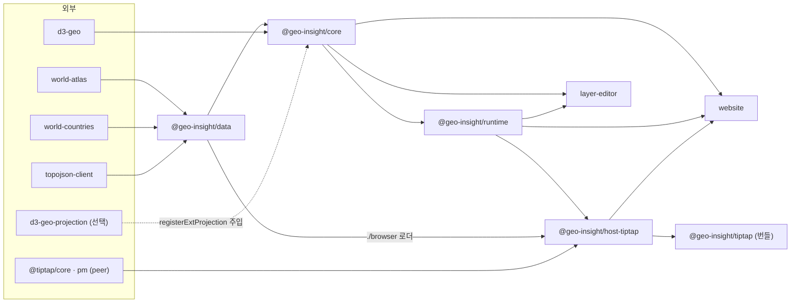
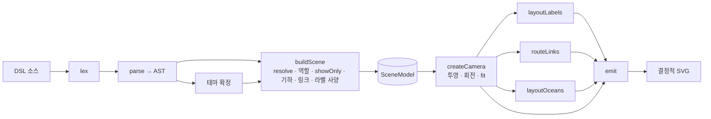
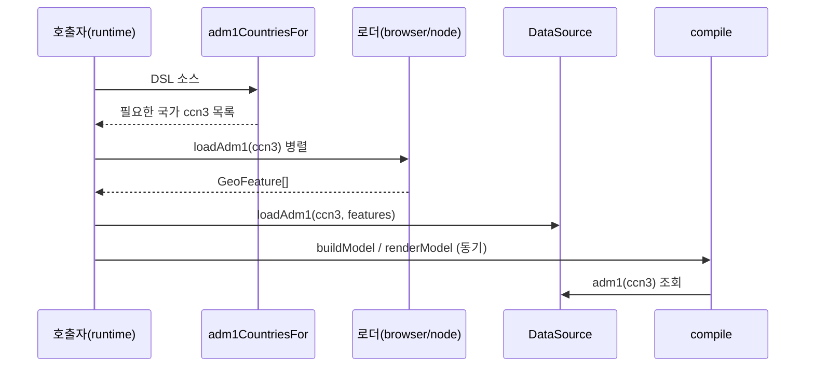
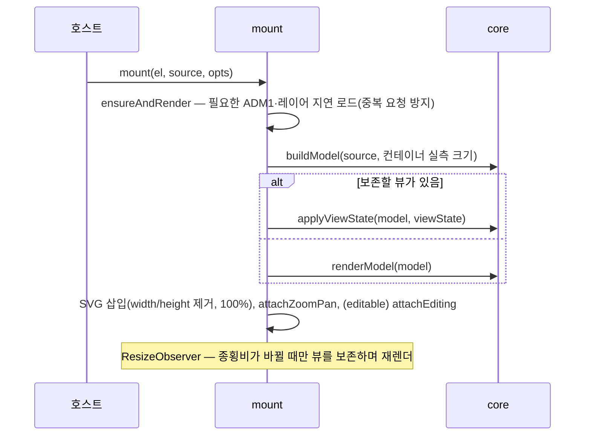
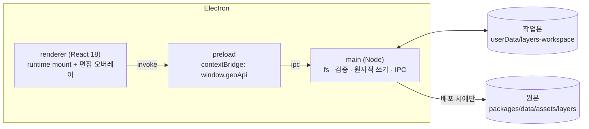

# GeoInsight 설계 문서

> **상태** 정식 · **기준** v0.3.0 (커밋 `d08a00c`) · **최종 갱신** 2026-10-16
>
> 이 문서는 **현재 코드의 실동작**을 기준으로 쓴다. 문서와 코드가 어긋나면 코드가 맞고,
> 이 문서를 고친다. 설계를 바꾸는 커밋은 이 문서의 해당 절도 함께 고친다.

## 문서의 위치

주제별 정본(가장 믿을 출처)은 다음과 같다. 이 문서는 나머지를 잇는 **아키텍처와 설계 결정**의
정본이다.

| 주제 | 정본 | 비고 |
|---|---|---|
| 아키텍처·설계 결정·불변식 | 이 문서 | |
| DSL 문법·어휘·기본값 | `packages/core/src/vocabulary.ts` → `DSL_SPEC` | 코드에서 파생 생성, 테스트가 드리프트를 막는다 (§13) |
| 설치·사용법 | `README.md`, 패키지별 `README.md` | |
| npm 릴리스 절차 | `CLAUDE.md` | |
| 백로그 | `docs/TODO.md` | |
| 최초 구상(v1 구현 프롬프트) | `geoinsight-v1-implementation-prompt.md` | **역사 기록**. 지금과 다른 점은 §19 |

## 목차

1. [개요](#1-개요)
2. [설계 원칙](#2-설계-원칙)
3. [시스템 구성](#3-시스템-구성)
4. [DSL 설계](#4-dsl-설계)
5. [컴파일러 파이프라인 (core)](#5-컴파일러-파이프라인-core)
6. [카메라와 투영](#6-카메라와-투영)
7. [링크(관계) 렌더링](#7-링크관계-렌더링)
8. [스타일과 테마](#8-스타일과-테마)
9. [데이터 계층 (data)](#9-데이터-계층-data)
10. [흐름 프리미티브와 큐레이션 레이어](#10-흐름-프리미티브와-큐레이션-레이어)
11. [런타임 (runtime)](#11-런타임-runtime)
12. [편집 오버레이와 DSL 텍스트 패치](#12-편집-오버레이와-dsl-텍스트-패치)
13. [LLM 파이프라인 진입점](#13-llm-파이프라인-진입점)
14. [호스트 통합 (Tiptap)](#14-호스트-통합-tiptap)
15. [레이어 에디터 (layer-editor)](#15-레이어-에디터-layer-editor)
16. [웹사이트와 예제](#16-웹사이트와-예제)
17. [빌드·테스트·릴리스](#17-빌드테스트릴리스)
18. [확장 지점](#18-확장-지점)
19. [v1 구상 대비 변경점](#19-v1-구상-대비-변경점)
20. [알려진 제약과 기술 부채](#20-알려진-제약과-기술-부채)
21. [미결 과제](#21-미결-과제)
22. [부록 — 용어와 파일 지도](#22-부록--용어와-파일-지도)

---

## 1. 개요

### 1.1 정체성

GeoInsight 는 **교육적 지리 설명을 위한 시맨틱 DSL → 결정적 SVG 렌더 엔진**이다.
"지도도 그릴 수 있는 차트 라이브러리"가 아니라 **"지도를 위한 Mermaid"** 를 지향한다.

- `미국`·`남미`·`인도` 같은 **장소 이름**과 `수단 -> 인도` 같은 **관계**를 1급 시민으로 다룬다.
- 위경도·투영·SVG 좌표는 전부 뒤로 숨긴다. 작성자는 "무엇을, 어떤 관계로" 쓰고,
  컴파일러가 "어디에, 어떻게" 그릴지 정한다.
- DSL 은 독립 파일이 아니다. 마크다운 펜스(```` ```geoinsight ````)로만 존재한다 — Mermaid 와
  같은 모델이다. 파일 확장자나 파일 로딩 개념이 없다.

```geoinsight
earth:
  show: 아프리카, 수단, 인도
  link: 수단 -> 인도
```

### 1.2 주 사용 시나리오

| # | 시나리오 | 쓰는 쪽 | 쓰는 표면 |
|---|---|---|---|
| 1 | 문서 에디터 안의 지도 블록 — 펜스로 임베드하고 지도 위에서 직접 편집 | 호스트(methii) 사용자 | `@geo-insight/tiptap` |
| 2 | LLM 이 DSL 을 생성하고 워커가 검증해 재생성 | LLM 파이프라인 | `core/spec`, `core/validate` |
| 3 | 환경 레이어(해류·바람) 데이터를 전문가가 그려 배포 | 도메인 전문가 | `layer-editor` |
| 4 | 정적 SVG 생성(빌드타임·테스트) | 개발자 | `compile()` |

### 1.3 목표와 비목표

**목표**

- 이름·역할·관계만으로 읽히는 지리 설명도를 만든다.
- 같은 입력이면 바이트 단위로 같은 SVG 를 낸다(스냅샷·버전 관리 가능).
- 하나의 core 를 어느 호스트에든 얹는다(DOM·프레임워크 비종속).
- 사람이 쓰든 LLM 이 쓰든, 누가 그려도 시각 품질이 같다(스타일은 시스템이 강제).

**비목표(현재 범위 밖)**

- 정량 인코딩 — choropleth, 데이터 바인딩, 수치 범례.
- 도시 단위 지명, 역사 지명(고구려·오스만 제국 등).
- 애니메이션, 타임라인, 멀티 씬 전환.
- 해외 영토 필터링(`parts: mainland`) — 지오메트리는 전부 그리고 카메라만 본토에 맞춘다.
- 외부 표준 지리 데이터 import/export.
- React 등 프레임워크 어댑터 — 런타임은 바닐라 DOM 하나로 충분하다.

---

## 2. 설계 원칙

### 2.1 불변 원칙 다섯

이 다섯은 v1 부터 바뀌지 않았다. 아래 표는 각 원칙이 **코드의 어디에서, 무엇으로** 지켜지는지다.

| # | 원칙 | 코드에서의 구현 | 지키는 장치 |
|---|---|---|---|
| 1 | **의미 우선** — 입력은 좌표가 아니라 이름·역할·관계 | resolver(이름 → 지오메트리), 역할 추론, `center`/`arrange` 의 이름 해석. 좌표는 `fit: [w,s,e,n]` 한 곳에서만 쓴다 | `DSL_SPEC` 이 LLM 에게 "fit 밖에서 위경도를 쓰지 말라"고 명시 |
| 2 | **결정적·diffable** — 같은 입력 = 바이트 동일 SVG | 좌표 반올림, ccn3 정렬, 등장 순서 기반 z, 안정 해시 색, 고정 속성 순서 (§5.5) | 골든 다이제스트 + SVG 체크섬 스냅샷 |
| 3 | **프레임워크 비종속 core** — 순수 함수 `compile(source)` | core 의존은 `@geo-insight/data`·`d3-geo` 뿐. I/O(ADM1·레이어 로드)는 compile 밖으로 뺐다 (§9.3) | `validate` 의존 그래프 테스트, 패키지 의존 규칙 (§3.3) |
| 4 | **헤드리스 core + 호스트 어댑터** | 줌·회전·편집은 runtime, Tiptap 통합은 host-tiptap, 배포는 번들 | 패키지 경계 |
| 5 | **교육적 서사가 목적** — 수치가 아니라 관계의 *이해* | 라벨·강조·화살표·좌우 배치, 흐름의 "이야기용 띠", 줌 종속 LOD | — |

### 2.2 파생 원칙

다섯 원칙을 실제로 지키며 굳어진 작업 규칙이다.

- **DSL 소스가 유일한 진실이다.** 편집 UI 는 화면 상태가 아니라 DSL 텍스트를 바꾼다. 회전·줌
  같은 휘발 상태는 DSL 에 기록하지 않는다(투영 모드 전환만 예외로 `projection:` 에 남긴다).
- **패치는 재직렬화가 아니라 표적 수정이다.** AST 를 다시 찍지 않고 해당 줄만 고친다 — 사용자의
  포맷·주석·명시형 블록이 보존된다 (§12).
- **compile 은 동기·순수, I/O 는 바깥.** 무거운 지오메트리는 2단계로 로드해 주입한다.
- **스타일은 시스템이 강제한다.** 면색은 팔레트에서 자동 배정, 흐름 곡선은 공유 보간 함수로
  고정된다. 작성자(사람·LLM·전문가)는 데이터만 넣는다.
- **문서는 실동작을 적는다.** "되는 것"뿐 아니라 "무시되는 것·안 되는 것"을 숨기지 않는다.
  어휘는 한 곳(`vocabulary.ts`)에서 나오고, 검사와 문서가 같은 표를 읽는다.
- **정의는 도메인이 아니라 메커니즘에 둔다.** "해류 지원"이 아니라 "중심선을 따라 흐르는
  방향성 띠"로 정의하면, 새 요구가 "지원할까 말까"가 아니라 "분류"가 된다 (§10.1).

---

## 3. 시스템 구성

### 3.1 패키지 지도

pnpm 모노레포(`pnpm@10.27.0`, Node ≥ 20, TypeScript 5.6.3). 발행 4패키지는 **lockstep**(같은 버전)이다.

| 패키지 | 디렉토리 | 역할 | 발행 | 빌드 |
|---|---|---|---|---|
| `@geo-insight/data` | `packages/data` | 지오메트리 + 이름 해석기 + 자산(ADM1·레이어) | O | tsc + 자산 복사 |
| `@geo-insight/core` | `packages/core` | DSL → IR → SVG 컴파일러, 검증기, 명세 | O | tsc (ESM, `parse` 만 CJS 추가) |
| `@geo-insight/runtime` | `packages/runtime` | 바닐라 DOM 마운트, 줌·회전, 편집 오버레이 | O | tsc + `styles.css` |
| `@geo-insight/tiptap` | `packages/host-tiptap-bundle` | 아래 전부를 인라인한 self-contained ESM 번들 | O | Rollup |
| `@geo-insight/host-tiptap` | `packages/host-tiptap` | Tiptap 노드 익스텐션(소스) | X | (번들에 인라인) |
| `@geo-insight/layer-editor` | `packages/layer-editor` | 환경 레이어 데이터 편집기(Electron) | X | electron-vite |
| `@geo-insight/website` | `website` | 플레이그라운드 + Tiptap 데모 | X | Vite |
| `@geo-insight/examples` | `examples` | 수용 예제 마크다운 | X | — |

### 3.2 의존 그래프



### 3.3 의존 규칙

| 패키지 | 허용 | 금지 |
|---|---|---|
| `core` | `@geo-insight/data`, `d3-geo` | DOM·`window`·React, `node:fs`. `d3-geo-projection` 은 동기 `require` 로 끌어오지 않고 호스트가 주입한다 |
| `data` | `world-atlas`, `world-countries`, `topojson-client` | `core`. 메인 배럴에 `node:fs` 금지(`./node` 로 분리) |
| `runtime` | `core`, 브라우저 DOM | React 등 프레임워크 |
| `host-tiptap` | `core`, `runtime`, `data/browser`, peer `@tiptap/*` | React(NodeView 는 바닐라 DOM) |
| `layer-editor`·`website` | 제한 없음(앱) | — |

### 3.4 서브경로 진입점

용도가 다른 호출자가 필요 없는 그래프를 끌고 오지 않도록 진입점을 쪼갰다.

| 진입점 | 담는 것 | 형식 | 비고 |
|---|---|---|---|
| `@geo-insight/core` | 컴파일·렌더·편집 패치 전부 + data 재노출 | ESM | 지오메트리 JSON 을 import 하므로 번들러 필요 |
| `@geo-insight/core/parse` | 문법 파서만 | ESM + CJS | 그래프 = parser·lexer·diagnostics. JSON 0 |
| `@geo-insight/core/validate` | 문법 + 지명 + 키/값 검증 | ESM | 데이터는 `data/names` 경량 색인만 |
| `@geo-insight/core/spec` | LLM 프롬프트용 명세 `DSL_SPEC` | ESM | |
| `@geo-insight/data` | resolver, DataSource, 그룹, ADM1 gazetteer | ESM | |
| `@geo-insight/data/node` | ADM1·레이어 디스크 로더 | ESM | `node:fs` 의존 |
| `@geo-insight/data/browser` | ADM1·레이어 동적 import 로더 | ESM | 번들러가 lazy 청크로 분해 |
| `@geo-insight/data/names` | 지오메트리 없는 이름 판정 | ESM | JSON import 0 |
| `@geo-insight/runtime` | `mount`, `attachZoomPan`, `attachEditing` | ESM | |
| `@geo-insight/runtime/styles.css` | 런타임 UI 스타일 | CSS | |
| `@geo-insight/tiptap` | Tiptap 익스텐션 + 펜스 유틸 | ESM | peer 는 `@tiptap/core`·`@tiptap/pm` 둘뿐 |

---

## 4. DSL 설계

> 키·열거값·기본값의 **정본은 `DSL_SPEC`** 이다. 이 절은 문법의 *구조와 설계 이유*를 다룬다.

### 4.1 임베딩

- 펜스 언어 태그는 `geoinsight`. 본문이 곧 DSL 이다.
- 호스트 표현 메타(높이 등)는 info-string 에 Pandoc 스타일로 붙인다: ```` ```geoinsight {height=500} ````.
  DSL 본문은 메타에 의존하지 않는다 — 메타 처리는 호스트 어댑터(§14) 몫이다.
- 진단의 `span`(line/col)은 **펜스 본문 기준 1-based** 다. 호스트가 문서 전체 오프셋이 필요하면
  펜스 시작 줄을 더한다.

### 4.2 문법

줄 지향 + 브레이스 문법이다. 들여쓰기는 가독성용이며 토큰화하지 않는다.

```text
program    := 'earth' STRING? ':' NEWLINE* statement*
statement  := sceneProp | entity | linkDecl | labelDecl | themeDecl
sceneProp  := WORD ':' value NEWLINE                  # show/showOnly/layers/center/arrange/fit/projection
                                                      # link/arrow/wind/current/route: A -> B "라벨"
entity     := ('group' | 'focus' | 'plain') name braceProps?
linkDecl   := 'link' name '->' name braceProps?        # 'link' 뒤가 ':' 가 아닐 때
labelDecl  := 'label' name braceProps?                # 'label' 뒤가 ':' 가 아닐 때, name 생략 시 'all'
themeDecl  := 'theme' braceProps                      # 'theme' 뒤가 '{' 일 때
braceProps := '{' (WORD ':' scalar (',' | NEWLINE)*)* '}'
```

**렉서 규칙** (`lexer.ts`)

| 토큰 | 규칙 |
|---|---|
| 개행 | 문장 구분자. 브레이스 안에서는 콤마와 동등 |
| 주석 | `#` 부터 줄 끝까지 — 그래서 `#ff8800` 같은 hex 색은 **표기 불가** |
| 문자열 | `"…"`, 한 줄 안, 이스케이프 없음 |
| 숫자 | `[-+]?digits(.digits)?`. `-` 뒤가 숫자·소수점일 때만 부호 |
| 화살표 | `->` |
| 단어 | 공백·특수문자(`: , { } [ ] " #`)·`->` 전까지 |

**이름 읽기** — 연속된 단어·문자열·숫자 토큰을 공백으로 이어 하나의 이름으로 만든다. 그래서
`show: South Korea, Japan` 처럼 여러 단어 이름이 따옴표 없이 된다.

**scene 속성 값** — 콜론 뒤 개행 전까지의 원시 텍스트(`raw`)를 보관하고, 콤마가 있으면 리스트로,
`->` 가 있으면 관계로 분해한다. 관계 우변 끝의 문자열 토큰은 링크 라벨로 떼어 낸다.

**브레이스 값 강제 변환** — 단일 숫자 토큰은 number, `true`/`false` 는 boolean, 나머지는 문자열
(여러 토큰이면 공백으로 결합).

**파서 진단** — `earth` 누락·`earth` 뒤 `:` 누락은 warning, 그 밖의 문법 오류는 error. 오류 줄은
건너뛰고 다음 문장부터 계속 읽는다(부분 렌더).

### 4.3 문장 종류

| 형태 | 예 | 의미 |
|---|---|---|
| scene 속성 | `show: 한국, 일본` | 그릴 엔티티, 카메라, 레이어 등 |
| 인라인 관계 | `wind: 태평양 -> 인도양 "무역풍"` | 키워드가 곧 링크 타입, 꼬리 문자열이 라벨 |
| 엔티티 블록 | `focus 한국 { fill: coral }` | 역할·스타일 명시 |
| 링크 블록 | `link 한국 -> 인도 { geodesic: true }` | 링크 속성 명시 |
| 라벨 블록 | `label 한국 { collide: true }` | 라벨 대상 지정 |
| 테마 블록 | `theme { ocean: powderblue }` | 4개 테마 키 오버라이드 |

### 4.4 역할 모델

| 역할 | 무엇 | 기본 면색 | z 순서 | 라벨 배치 우선순위 |
|---|---|---|---|---|
| `group` | 대륙·권역 | `groupPalette` 를 등장 순으로 순환 | 아래(`0×1000 + i`) | 3순위 |
| `plain` | 그 외 선택 지역 | `selectPalette` 안정 해시 (§8.2) | 위(`1×1000 + i`) | 2순위 |
| `focus` | 명시했을 때만 | `plain` 과 같음 | 위(`1×1000 + i`) | 1순위 |

- **추론 규칙**: 해석 결과가 그룹이면 `group`, 나머지는 `plain`. 명시 선언(`group|focus|plain NAME`)이
  추론을 덮는다.
- **link 끝점은 강조색을 받지 않는다.** v1 은 link 끝점을 `focus` 로 추론해 강조색을 줬지만 지금은
  아니다 — 관계는 화살표로만 표현하고, 끝점은 자기 선택색을 유지한다.
- `showOnly` 가 자동으로 깐 행정구역 캔버스는 z 를 `-100000 + i` 로 맨 아래에 둔다.

### 4.5 해석되는 이름

이름은 세 종류뿐이다.

1. **국가** — 현대 주권국과 속령. 한글·영문의 통용명·공식명, ISO alpha-2/alpha-3, 대체 표기
   (`world-countries` 기준).
2. **그룹** — 대륙 6개(아프리카·아시아·유럽·오세아니아·아메리카·남극)와 권역 19개(동남아시아·중동·
   남미·카리브 등), 한·영 별칭 포함. 정의는 `data/src/groups.ts` 의 `GROUP_DEFS`.
3. **ADM1(1차 행정구역)** — Natural Earth 기준 234개국 4,529개. 유일하면 맨 이름(`California`,
   `텍사스`), 모호하면 스코프 표기(`미국.캘리포니아`).

**역사 지명은 해석되지 않는다.** 역사 서사는 대응하는 현대 영토로 표현한다.

**해석 우선순위** (resolver 와 `names` 경로가 동일)

```text
0. 'A.B' 스코프 표기  → A 를 국가로, B 를 그 국가의 ADM1 로
1. 그룹 별칭          → 국가 정확 일치보다 먼저
2. 국가 정확 일치      → ADM1 보다 먼저 (Georgia 는 국가)
3. ADM1              → 정확히 하나일 때만
4. 부분 일치          → 정확히 하나일 때만
5. 그 외              → unknown + suggestions(최대 8개, 가나다순)
```

- 이름 비교는 `normalizeName` — 소문자화 + 공백·하이픈·언더스코어 제거.
- 정확 일치가 여러 국가에 걸리면, UN 회원 독립국이 하나뿐일 때 그것으로 정한다(`인도` →
  India, 영국령 인도양 지역이 아니라).
- 그룹 별칭이 국가 이름을 가리면 안 되므로, `Southern Africa` 권역 별칭에서 `남아프리카`를 뺐다
  (`남아프리카` = 남아프리카 공화국).

### 4.6 기본값과 우선순위

| 항목 | 기본값 |
|---|---|
| `projection` | `equirectangular` (flat 모드) |
| `fit` | `dominant` |
| `curve` | `0.25` |
| `anchor` | `border` |
| `geodesic` | `false` |
| `collide` | `true` |
| `labelAt` | `mid` |
| `head` | `arrow`→`taper`, `wind`·`current`→`triangle`, `route`→`none` |
| 출력 크기 | 너비 960, 높이 너비×0.6, 좌표 정밀도 2자리 |

- 관계 꼬리 문자열 라벨 > 블록의 `label:`.
- 관계 키워드(`wind`/`current`/`route`) > 블록의 `type:`.
- 명시 `fit` > `showOnly` 의 자동 프레이밍.
- DSL 의 `projection`·`center` > `CompileOptions` 의 기본값.

### 4.7 실동작 주의

LLM 과 사람이 가장 많이 틀리는 경계다. `DSL_SPEC` 8절과 같은 내용이다.

| 입력 | 실제 동작 |
|---|---|
| `arrow: taper` / `arrow: triangle` | **무시**. 정식 키는 `head`. `arrow: line` 만 하위호환으로 `head: none` |
| `label { place: … }` | **무시**. 라벨은 항상 중심점(centroid) |
| `fill: #ff8800` | `#` 이 주석이라 파싱이 깨진다. 색 토큰이나 CSS 색 이름을 쓴다 |
| `label` 문장이 하나라도 있음 | 암묵적 "전부 라벨"이 사라지고 **지명된 대상만** 라벨이 붙는다 |
| 미지 엔티티·링크 속성, 잘못된 `fit`, 없는 색 | `compile` 은 조용히 무시(잘못된 `fit` 은 `dominant` 로). `validate` 는 진단으로 잡는다 |
| 미지 scene 키, 미지 투영 | `compile` 도 error 진단 |
| `head` 값 | `taper`·`wedge` → taper, `triangle`, `none`·`line` → none |

### 4.8 어휘의 단일 출처

`vocabulary.ts` 가 scene 키·속성 키·열거값·기본값을 한 번만 정의하고, `validate`(검사)와
`spec`(문서 생성)이 같은 상수를 읽는다. 렌더 경로(`build-scene.ts`)는 이 표를 직접 import 하지
않으므로, **테스트가 소스를 읽어 대조한다** (§13.4).

---

## 5. 컴파일러 파이프라인 (core)

### 5.1 전체 흐름



### 5.2 buildModel / renderModel 분리

대화형 런타임은 드래그마다 지구를 다시 투영해야 한다. parse·resolve·지오메트리 조립은 무겁고
카메라와 무관하므로 둘로 갈랐다.

| 함수 | 하는 일 | 쓰는 쪽 |
|---|---|---|
| `buildModel(source, opts)` | parse → 테마 → buildScene. 카메라 이전까지 | 런타임이 캐시 |
| `renderModel(model, ropts)` | 카메라 이후 전 패스 → 완전한 SVG + IR + meta | 최초 렌더, 정적 출력 |
| `renderContent` | `gi-content` 내부 마크업만 | 회전 재투영 |
| `renderAnnotations` | `gi-annotations` 내부만 | 줌(주석 크기 보정) |
| `renderFlows` | `gi-flows` 내부만 | 줌(흐름 두께·가시성) |
| `compile(source, opts)` | `renderModel(buildModel(...))` | 비대화형 호출의 유일한 진입점 |

`SceneModel` 은 `built`(BuiltScene), `theme`, `dataSource`, `resolver`, `locator`(5대양 바다 판정용
공유 인스턴스), `width`·`height`·`precision`, 모델 수준 진단을 담는다.

**RenderOptions**

| 옵션 | 의미 |
|---|---|
| `fixed` | fit 을 건너뛰고 `{rotate, scale, translate}` 로 카메라 고정 — "프레이밍은 그대로, 지구만 회전" |
| `coarse` | 배경 세계를 110m 로(드래그 중 값싼 재렌더) |
| `annotationScale` | 현재 viewBox 폭 / 기본 폭. 주석 크기를 곱해 줌 배율을 상쇄 |
| `pxPerKm` | 현재 줌의 화면 px/km. 주면 흐름 LOD 가 켜진다 (§10.4) |
| `flowWidthParams` | 흐름 두께 모델 파라미터(라이브 튜닝) |

### 5.3 패스별 명세

#### 5.3.1 테마 확정

DSL `theme { }` 블록(4키) → `CompileOptions.theme`(부분) → `DEFAULT_THEME` 순으로 덮는다. 중첩
슬롯(`label`·`oceanLabel`·`subdivision`·`hover`·`layers`·`tokens`)은 깊게 병합한다. 엔티티
스타일링 전에 최종 테마가 정해져야 하므로 `compile.ts` 가 AST 에서 테마 블록만 먼저 뽑는다.

#### 5.3.2 buildScene — Resolve → Roles → showOnly → Geometry

1. **scene 설정 수집** — `show`·`showOnly`·`layers`·`arrange`·`center`·`fit`·`projection` 과 링크 계열
   키워드(`link`·`arrow`·`wind`·`current`·`route`)를 처리. 미지 키·미지 투영은 error.
2. **이름 수집(안정 순서)** — `show` → 엔티티 선언 → 링크 끝점 → `arrange` 끝점. `normalizeName` 으로
   중복 제거. 링크·`arrange` 끝점은 `show` 에 없어도 엔티티가 된다.
3. **해석** — 이름마다 resolver 호출. 미해석은 error + suggestions 를 남기고 건너뛴다. 같은 key 는
   첫 등장만 남긴다.
4. **명시 역할·스타일** 적용.
5. **showOnly(격리 모드)** — 대상은 단일 국가여야 한다(아니면 error 후 무시).
   - 원시 이름을 ccn3 로 바꾸고, 대상 국가 자체의 ADM0 엔티티는 지운다(캔버스를 덮으므로).
   - 로드된 ADM1 을 "캔버스" 엔티티로 자동으로 채운다(라벨 없음, 중립색). ADM1 이 없으면 ADM0
     실루엣으로 대신한다.
   - 대상 국가에 속하지 않는 엔티티는 제외한다.
   - 명시 `fit` 이 없으면 **본토**(국가의 최대 폴리곤) bbox 로 프레이밍한다 — 알래스카·하와이 같은
     원격 영토로 화면이 퍼지지 않게. `center` 가 없으면 본토 중심 경도.
6. **역할 추론·z·스타일·기하** — §4.4 의 규칙. 중심점·bbox 는 d3-geo 구면 계산(`geoCentroid`·`geoBounds`).
7. **z 오름차순 정렬** — group 아래, plain/focus 위.
8. **링크 사양** — 끝점을 이름 → key 로 바꾼다. 못 바꾸면 error. 타입은 키워드 > `type:` > `arrow`.
9. **라벨 사양** — `label` 문장이 없으면 `label all`. `all` 은 `style.label` 이 참인 엔티티 전부,
   `label NAME` 은 해당 엔티티 하나.

#### 5.3.3 Project & Fit

§6 참조.

#### 5.3.4 라벨 배치

- 우선순위 focus > plain > group 으로 정렬하고, 동순위는 입력 순서(결정적).
- globe 뒷면 좌표는 컬링한다.
- `collide` 면 겹칠 때 위아래로 번갈아 한 칸(`높이+2`)씩, 최대 8회 밀어낸다.
- **프레임 clamp 를 하지 않는다.** 지역이 화면을 벗어나면 라벨도 함께 벗어나야 지역과 라벨의
  대응이 유지된다.
- 글자 크기는 `theme.label.size × annotationScale` — 줌과 무관하게 화면상 크기가 일정하다.

#### 5.3.5 링크 라우팅

§7 참조.

#### 5.3.6 5대양 라벨

- 북극해·태평양·대서양·인도양·남극해를 바다 한가운데 대표 좌표에 고정해 투영한다.
- 대표점이 프레임을 조금(15% 이내) 벗어났으면 안쪽(가장자리 24px)으로 끌어오되, **끌어온 지점이
  여전히 바다일 때만** 그린다(locator 로 육지 판정 — 육지 위 오배치 방지).
- globe 뒷면, 격리 모드에서는 그리지 않는다.

#### 5.3.7 Emit

§5.4 참조.

### 5.4 SVG 출력 구조

```text
<svg class="geoinsight" viewBox="…" width="…" height="…" role="img">
  <g class="gi-content">
    <g class="gi-geometry">     바다(sphere) → 경위선 → 배경 세계 → 레이어 면 → 행정구역 맥락선 → 엔티티(z순)
    <g class="gi-flows">        <defs>(방향 그라데이션) → <g class="gi-flow"> × N
    <g class="gi-annotations">  5대양 라벨 → 레이어 점 마커 → 마커 라벨 → 링크 path + 히트 영역 → 엔티티·링크 라벨
  </g>
</svg>
```

그룹을 셋으로 나눈 이유는 **다시 그리는 빈도가 다르기 때문**이다.

| 이벤트 | 다시 그리는 범위 | 이유 |
|---|---|---|
| 회전(팬) | `gi-content` 전체 | 투영이 바뀌므로 전부 재투영 |
| 줌 | `gi-annotations` + `gi-flows` | 지오메트리는 viewBox 가 스케일하면 끝. 주석은 화면상 크기를 유지해야 하고, 흐름은 두께·가시성이 줌 종속 |
| 소스 변경 | SVG 전체 | 모델 재빌드 |

- **격리 모드**(`showOnly`)에서는 바다·경위선·배경 세계·레이어·5대양 라벨·흐름을 생략한다.
- 지오메트리 선은 `vector-effect: non-scaling-stroke` — 줌해도 선 두께가 화면상 일정하다.
- 런타임 히트테스트용 속성: `data-key`(엔티티·라벨), `data-link="from>to"`(링크),
  `data-layer`·`data-id`(레이어 피처), `data-adm0`(행정구역 맥락선).
- ADM1 엔티티가 있는 국가는(격리 모드가 아닐 때) 그 나라의 전체 주·도 경계를 엔티티 아래에 옅게
  깔아 "어느 나라의 어느 주"인지 읽히게 한다.

### 5.5 결정성 보장 장치

| 장치 | 위치 |
|---|---|
| 모든 좌표를 `precision`(기본 2) 자리로 반올림, path `d` 의 숫자도 정규식으로 반올림, `-0` → `0` | `projection.ts` `round`·`roundPath` |
| `meta` 의 scale·translate 는 4자리 반올림 | `camera.ts` |
| 국가 feature 를 ccn3 숫자 오름차순으로 정렬, 그룹 멤버 순서도 이를 따름 | `data/countries.ts` |
| 엔티티 순서 = 이름 등장 순서 → z → 안정 정렬 | `build-scene.ts` |
| 면색 = key 의 FNV-1a 해시 → 확장 팔레트 인덱스 | `color.ts` |
| 라벨 우선순위 정렬의 동순위는 입력 순서 | `labels.ts` |
| SVG 속성 순서 고정(객체 삽입 순서) | `emit.ts` |

"같은 입력"의 정확한 뜻은 **같은 소스 + 같은 옵션 + 같은 데이터 상태**다. ADM1·레이어가 로드됐는지,
확장 투영이 등록됐는지가 출력에 영향을 준다.

### 5.6 진단 모델

```ts
interface Diagnostic {
  level: 'error' | 'warning';
  message: string;          // 한국어
  span?: { line: number; col: number };   // 펜스 본문 기준 1-based
  suggestions?: string[];   // "수단 vs 남수단" 같은 명확화 제안
}
```

- 출처: 파서, buildScene(미해석 이름·잘못된 링크 끝점·미지 키·showOnly 오류), 카메라(확장 투영
  폴백 warning).
- **부분 렌더(graceful degradation)** — error 가 있어도 해석된 만큼은 그린다. 미해석 이름은 빠지고
  나머지는 정상 출력된다.

### 5.7 공개 IR

```ts
interface CompileResult { svg: string; scene: Scene; diagnostics: Diagnostic[]; meta: SceneMeta }

interface Scene {
  title?: string;
  showOnly?: string;                 // 격리 대상 ccn3
  layers?: string[];                 // 켜진 레이어 이름
  projection: { type: ProjectionType; rotate: [number, number] };
  fit: FitSpec;
  theme: Theme;
  entities: Entity[];
  links: Link[];
  labels: Label[];
  meta: SceneMeta;
}

interface Entity {
  key: string;            // 국가 = ccn3, 그룹 = 'group:africa', ADM1 = adm1_code('USA-3521')
  display: string;        // 사용자가 쓴 원문(자동 캔버스 ADM1 은 한글명)
  role: 'group' | 'focus' | 'plain';
  features: GeoFeature[];
  centroid: [number, number];
  bbox: [number, number, number, number];
  z: number;
  level: 0 | 1 | 2;       // 0 = 국가, 1 = ADM1, 2 = ADM2(자리만)
  adm0?: string;          // ADM1 의 소속 국가 ccn3
  style: { fill; stroke; borders; label; opacity };
}

interface SceneMeta {
  viewBox: [number, number, number, number];
  width: number; height: number; precision: number;
  projectionParams: { type; rotate; scale; translate };   // 런타임이 카메라를 그대로 재구성
}
```

---

## 6. 카메라와 투영

### 6.1 투영 포트

`projection.ts` 의 `createProjection(type)` 이 d3-geo 투영을 만든다.

| 타입 | 출처 | 비고 |
|---|---|---|
| `equirectangular` | d3-geo | **기본값**. flat 모드 |
| `orthographic` | d3-geo | globe 모드 |
| `naturalEarth1`, `mercator` | d3-geo | |
| `robinson`, `winkel3` | `d3-geo-projection` | 호스트가 `registerExtProjection` 으로 주입해야 한다. 미등록이면 `naturalEarth1` 로 폴백하고 warning |

확장 투영을 동기 `require` 로 끌어오지 않는 이유: 브라우저 번들에 `node:module` 이 새지 않게 하고,
번들을 가볍게 유지하기 위해서다.

### 6.2 center 해석

회전 `rotate = [-centerLon, 0]` 은 **fit 보다 먼저** 적용한다.

```text
1. arrange: A -> B   → A 가 왼쪽, B 가 오른쪽이 되는 중앙 자오선(두 중심 경도 사이 호의 중점,
                       A 가 오른쪽에 오면 반대편 중점으로 뒤집음)
2. center: 숫자       → 그 경도
3. center: 프리셋     → pacific·태평양=180, atlantic·대서양=-30, indian·인도양=80, greenwich·본초자오선=0
4. center: 이름       → 표시 엔티티 중 같은 이름의 중심 경도, 없으면 resolver 로 해석한 중심 경도
5. 그 외              → 0
```

### 6.3 fit 모드

| 모드 | 프레이밍 대상 | 맞춤 방식 |
|---|---|---|
| `dominant`(기본) | 엔티티마다 **최대 면적 단일 폴리곤**(MultiPolygon 은 쪼개서 비교)의 합 | meet(내접) + 여백 |
| `entities` | 엔티티 전체 지오메트리 | meet + 여백 |
| `world` | 구 전체(Sphere) | **cover** — 여백 없이 viewBox 를 채움 |
| `[w,s,e,n]` | 경위도 사각형 | meet + 여백 |
| (대상 없음) | Sphere 로 폴백 | cover |

- 여백은 `min(너비, 높이) × 6%`, 격리 모드는 10%(뷰포트의 약 80% 에 맞춤).
- **dominant 가 기본인 이유**: 프랑스·미국처럼 해외 영토가 있는 나라를 전부 담으면 카메라가
  폭주한다. 지오메트리는 전부 그리되 프레이밍만 주 클러스터에 맞추고, 먼 조각은 줌·팬으로 탐색한다.
- **world 가 cover 인 이유**: d3 `fitExtent` 는 meet 만 지원해서 2:1 구를 다른 종횡비 뷰포트에
  내접시키면 위아래에 바다색 띠가 생긴다. `fitCover` 가 scale 1 기준 bounds 로 cover 배율을 구한다.
- **bbox 를 Polygon 이 아니라 MultiPoint 로 주는 이유**: 구면에서 Polygon 은 고리 방향(winding)이
  모호해 d3 가 여집합(전세계)으로 해석할 수 있다. 네 변을 16단계로 샘플한 점 집합은 모호성이 없다.
- **orthographic(globe)** 은 fit 모드와 무관하게 **디스크 전체를 뷰포트 중앙에** 맞춘다(회전으로는
  디스크 위치를 못 옮기므로). 대신 회전으로 조준한다 — `center`/`arrange` 가 있으면 `[-lon, 0]`, 없으면
  fit 대상 지오메트리의 구면 중심 `[-lon, -lat]` 을 정면으로.

### 6.4 가시성 컬링

`orthographic` 은 뒷면 좌표도 디스크 위에 투영해 버리므로, `camera.visible(lonlat)` 이 화면 중심에서
`π/2 − 0.02` 라디안 밖이면 거짓을 돌려준다. 라벨·링크(양 끝점)·레이어 마커·흐름 화살촉·흐름
라벨이 이 판정으로 컬링된다. 그 밖의 투영은 항상 참이다.

### 6.5 cameraFromMeta

`meta.projectionParams` 만으로 fit 을 다시 돌리지 않고 같은 투영을 재구성한다(`project`·`unproject`·
`path`·`bounds`). 런타임의 hover 하이라이트, 클릭 역변환, 세계 범위 계산이 이것을 쓴다 —
emit 과 **같은 좌표계**가 보장된다.

---

## 7. 링크(관계) 렌더링

### 7.1 중심선

| 조건 | 샘플링 |
|---|---|
| `geodesic: true` | 대권선(`geoInterpolate`)을 64 구간으로 샘플한 뒤 투영 |
| `geodesic: false` | 화면 좌표 2차 베지어. 제어점 = 중점 + 법선 × `curve` × 길이. 64 구간 |

### 7.2 anchor

- `border`(기본): 두 엔티티의 **외곽 고리**(구멍 제외)를 투영해, 중심선 샘플 중 출발 엔티티 밖으로
  처음 나가는 점을 시작으로, 도착 엔티티 안으로 처음 들어가는 점을 끝(tip)으로 자른다(광선 교차
  점-내포 판정). 그래서 화살표가 **국경에서 출발해 국경에 닿는다.**
- `centroid`: 중심점에서 중심점까지 전체.
- 화살촉 길이만큼 몸통을 tip 앞에서 끊는다.
- globe 에서 어느 한 끝점 중심이 뒷면이면 링크 전체를 그리지 않는다.

### 7.3 타입별 외형

| 타입 | 몸통 | 화살촉 | 대표 용도 |
|---|---|---|---|
| `arrow` | 채워진 taper wedge(시작 1.5px → 끝 6px). `head: none` 이면 2px 선 | taper 는 삼각형 | 일반 관계 |
| `wind` | 2px 점선(7, 5) | 삼각형 | 바람 |
| `current` | 2.5px 물결선(진폭 4, 양 끝 진폭 0) | 삼각형 | 해류 |
| `route` | 1.5px 점선(2, 5) | 없음 | 경로 |

- 화살촉은 길이 14px × 폭 12px.
- 두께·화살촉·점선 간격은 `annotationScale` 로 곱해 **화면상 일정**하다. 중심선의 길이는 줌과 함께
  자연스럽게 늘어난다.
- 클릭용으로 투명한 14px 히트 path(`gi-link-hit`, `data-link`)를 함께 낸다.
- 라벨은 몸통의 시작·중간·끝(`labelAt`) 지점 8px 위.

### 7.4 렌더러 레지스트리

`registerLinkRenderer(type, (geo: LinkGeometry) => RoutedPath[])` 로 타입별 외형을 교체할 수 있다.
렌더러는 몸통 폴리라인·tip·tip 접선·스타일을 받아 path 목록을 돌려준다.

> DSL 은 `LINK_KEYWORDS` 밖의 타입 이름을 만들지 못한다(`toLinkType` 이 그 밖의 값을 버린다).
> 따라서 레지스트리는 지금 **빌트인 타입 외형 교체**용으로만 동작한다. 새 타입 이름을 열려면
> 어휘·build-scene 확장이 함께 필요하다.

---

## 8. 스타일과 테마

### 8.1 Theme 슬롯

| 슬롯 | 용도 |
|---|---|
| `ocean`, `graticule` | 바다 구, 경위선 |
| `worldFaint`, `worldStroke` | 선택되지 않은 나라의 면·경계 (격리 모드 캔버스도 재사용) |
| `groupPalette` | 대륙·권역 면색 순환(6색) |
| `selectPalette` | 선택 지역 면색 시드(8색 파스텔) |
| `focusAccent` | (현재 미사용 — §20.3) |
| `linkColor` | 링크 기본색 |
| `label` | 라벨 글자색·헤일로·폰트·크기(13) |
| `oceanLabel` | 5대양 라벨 색·크기(15)·자간 |
| `subdivision` | ADM1 강조 면·경계, 행정구역 맥락선 |
| `hover` | 런타임 hover 하이라이트 면·선 |
| `layers` | 흐름 `kind` → 색 (`warm`·`cold`·`trade`·`westerly`·`polar`) |
| `tokens` | 색 토큰 → hex |

기본 테마는 크림색 육지 + 하늘색 바다의 밝은 파스텔 계열이다. 호스트 어댑터는 `theme: 'light'`
힌트를 받으면 바다·육지·라벨을 더 밝은 값으로 덮는다(§14.3).

### 8.2 면색 배정

- **group** — `groupPalette[등장 순번 % 6]`.
- **plain/focus** — `pickSelectFill(key)`: 시드 8색을 24색으로 확장한 팔레트에서 **key 의 안정 해시**로
  고른다. 확장분은 시드의 평균 채도·명도를 유지한 채 색상(Hue)만 황금각(137.508°)씩 회전해 만든다.
  배정 기준이 등장 순서가 아니라 key 이므로 **같은 지역은 어느 문서에서나 같은 색**이다.
- **ADM1** — 면색은 같은 규칙, 경계는 `subdivision.stroke`.
- **명시 `fill`·`stroke`** — 색 토큰이면 hex 로, 아니면 그대로(CSS 색 이름) 흘려보낸다.

### 8.3 색 토큰

`amber`·`coral`·`teal`·`slate`·`indigo`·`moss`·`sand`·`rose`·`sky` 9개. DSL 에서 hex 는 쓸 수 없으므로
(§4.7) 토큰 또는 CSS 색 이름만 유효하다.

### 8.4 런타임 CSS

`runtime/styles.css` 는 전부 `[data-geoinsight-root]` 아래로 범위를 한정한다 — 호스트 전역 CSS 와
충돌하지 않게. 라벨 포인터 이벤트, 편집 UI(퀵칩·메뉴·툴팁·모드 버튼·나가기 버튼·레이어 패널)를 담는다.

---

## 9. 데이터 계층 (data)

### 9.1 DataSource 포트

지오메트리 공급을 인터페이스 뒤에 둬서 고해상도·커스텀·원격 데이터를 끼울 수 있게 했다.

```ts
interface DataSource {
  countryByCode(ccn3): GeoFeature | undefined;
  allCountries(): GeoFeature[];                  // ccn3 오름차순
  coarseCountries?(): GeoFeature[];              // 드래그용 저해상도(선택)
  adm1(ccn3): GeoFeature[];                      // 이미 로드된 것만
  loadAdm1(ccn3, features): void;                // 2단계 로딩의 쓰기 쪽
  layer(name): LayerFeature[];                   // 이미 로드된 것만
  loadLayer(name, features): void;
}
```

### 9.2 지오메트리 출처

| 데이터 | 출처·가공 | 형태 |
|---|---|---|
| 국가(기본) | `world-atlas` countries-**50m** topojson → `topojson-client` 로 GeoJSON. `world-countries` 와 ccn3 로 조인(한글명·ISO·region·subregion) | 메모리 캐시 |
| 국가(드래그용) | `world-atlas` countries-**110m** | `coarseCountries()` |
| ADM1 지오메트리 | Natural Earth 10m `admin_1_states_provinces` → mapshaper(필드 정리, 12% Visvalingam 단순화, 국가별 분리) → 고리 방향을 d3 규약(외곽 시계방향)으로 보정 → ccn3 매핑 | `assets/adm1/<ccn3>.json` 234개, 약 5.5MB |
| ADM1 gazetteer | 같은 원천에서 지오메트리 없이 이름·별칭·코드만 | `assets/adm1-index.json` 4,529항목, 약 792KB |
| 레이어 | 큐레이션 데이터 | `assets/layers/index.json` + `currents.json`(흐름 15) + `winds.json`(흐름 12) |

- 조인에 실패한 지오메트리(분쟁 지역 `-99` 등)는 버리지 않고 이름만 폴백으로 채운다 — 이름으로
  해석은 안 되지만 그림에서 빠지지 않는다.
- ADM1 key 는 `adm1_code`(예: `USA-3521`), `iso_3166_2` 는 `properties.iso` 에 둔다.
- ADM1 명칭은 Natural Earth 원본(`name`·`name_en`·`name_local`·`name_ko`) 그대로다. 별도 한글 보강
  테이블은 만들지 않는다.
- 고리 방향 보정이 필요한 이유: NE GeoJSON 은 RFC 7946(외곽 반시계)이지만 d3-geo 는 외곽 시계방향을
  기대한다. 어긋나면 폴리곤이 구면 여집합으로 해석돼 bbox 가 전세계로 폭주한다.

### 9.3 2단계 로딩

compile 을 동기·순수로 유지하면서, 번들이 **필요한 나라의 ADM1 만** 받게 하는 구조다.



**`adm1CountriesFor` 의 판정** — 소스에 나온 모든 장소 토큰(점 표기는 양쪽으로 분해)에 대해:

- gazetteer 에 있는 ADM1 이름 → 그 소속 국가(먼저 확인해 resolver 의 느슨한 부분 일치에 오염되지 않게).
- 국가 이름 → 그 국가(주를 이어서 추가할 수 있게).
- 그룹은 제외(멤버 수 폭증 방지).

레이어도 같은 패턴이다 — 런타임이 소스의 `layers:` 줄에서 이름을 뽑아 `loadLayer` 로 주입한다.

resolver 는 **로드된 국가 안에서만** ADM1 을 해석한다. 그래서 데이터를 주입하지 않은 맨
`compile()` 은 `California` 를 해석하지 못한다(§20.1).

### 9.4 Resolver

- `resolve(name)` — §4.5 의 우선순위. 동기.
- `search(query, limit=10)` — 편집 UI 자동완성용. 그룹을 먼저, 국가는 정확 3점·접두 2점·부분 1점 +
  독립 주권국 0.5점으로 정렬.

### 9.5 지오메트리 없는 이름 경로 (`data/names`)

검증만 하는 호출자(LLM 워커)에게 840KB 세계 지오메트리와 topojson 디코딩은 낭비이고, JSON 정적
import 는 Node 20/22+ 에서 import attribute 누락으로 즉시 죽는다. 그래서:

- `scripts/build-name-index.mjs` 가 `world-countries` + ADM1 gazetteer + 레이어 index 에서 이름 해석에
  필요한 필드만 뽑아 `src/generated/name-index.js` 를 굽는다.
- JSON 이 아니라 **JS 모듈**로 굽는다 — 모든 Node 버전·번들러에서 조건 없이 동작한다.
- `.ts` 가 아니라 `.js` + `.d.ts` 로 굽는다 — 거대한 배열 리터럴을 tsc 가 타입 추론하지 않게.
- `checkName` 은 resolver 와 같은 우선순위로 판정한다. **유일한 의도적 차이**: ADM1 을 로드 여부와
  무관하게 gazetteer 전체에서 해석한다. 브라우저 런타임은 필요한 국가를 자동 로드하므로 이 기준이
  실제 렌더 결과와 일치한다.

### 9.6 Locator (역지오코딩)

`createLocator().locate([lon, lat])` — 전체 국가에 `geoContains` 를 순회(O(n)). 편집 클릭("어느
나라를 눌렀나")과 5대양 라벨의 바다 판정에 쓴다. 대륙은 식별하지 않는다(클릭은 국가 단위).

---

## 10. 흐름 프리미티브와 큐레이션 레이어

### 10.1 정의 — 메커니즘으로

> **흐름 = 중심선을 따라 흐르는 방향성 띠 (directed ribbon along a centerline).**

해류·바람·이주·무역로·공격축은 이 **한 메커니즘의 인스턴스**다. 각각이 새 프리미티브가 아니다.

| 구분 | 내용 |
|---|---|
| 정체성(불변) | 중심선 · 방향성 · 띠 렌더. 이게 깨지면 흐름이 아니라 다른 프리미티브 |
| 파라미터(가변) | `kind`(색) · 굵기 · 화살촉 · 점선 · (향후) 채널 수 · 추상화 모드 |
| 흐름이 아닌 것 | 스칼라장(수온·염도 → 면·등치선), 수직 운동(용승·침강 → 점), 닫힌 회전(와류), 분포·밀도(면·히트맵) |

새 요구의 판단 절차: ① 중심선 위 방향 띠인가 — 아니면 흐름 밖 → ② 기존 파라미터로 되나 — 되면
그냥 데이터 → ③ 새 표현이 필요하면 그것이 **직교 파라미터**(다른 케이스에도 재사용되나)인지 확인 후 추가.

**두 레지스터** — `width` 의 의미를 모드로 갈라 충돌을 없앤다.

- `geographic`(구현됨): 경로 = 실제 위치, `width` = 실제 폭(km), 줌 종속 LOD.
- `schematic`(향후): 경로 = 도식, `width` = 강조 굵기, LOD 끔. 개념 순환도 같은 "이야기용" 띠.

### 10.2 레이어 데이터 모델

```jsonc
{
  "type": "Feature",
  "id": "current:kuroshio",
  // 중심선 제어점(경도, 위도) — 최소 3점, 순서가 곧 방향
  "geometry": { "type": "LineString", "coordinates": [[122.0, 24.0], [127.5, 29.0], [131.0, 32.0], [140.0, 35.0]] },
  "properties": { "prim": "flow", "kind": "warm", "width": 90, "arrow": true, "dash": false,
                  "name": "Kuroshio", "kor": "쿠로시오 해류" }
}
```

- **geometry = 중심선 제어점(최소 3점), properties = 표현 파라미터.** 저장이 무손실이고 복원에
  역변환이 없다. 외부 표준 형식과의 변환은 하지 않는다(이 영역엔 쓸 표준 데이터가 없어 편집기를 만든 것).
- 좌표 순서가 곧 흐름 방향이다.

| geometry | 렌더 | 그룹 |
|---|---|---|
| `LineString` + `prim: 'flow'` | 흐름(§10.5) | `gi-flows` |
| `Point` / `MultiPoint` | 흰 테두리 원 마커, 반지름 ∝ `size`, 아래에 `kor` 라벨 | `gi-annotations` |
| `Polygon` / `MultiPolygon` | 반투명 면(fill 18%, 선 60%) | `gi-geometry` |
| `prim` 없는 `LineString`, `MultiLineString` | **그리지 않는다** | — |

### 10.3 보간 — 공유 카디널 스플라인

`core/flow.ts` 의 `cardinalSpline(pts, 16)` — uniform Catmull-Rom, 제어점 구간당 16 샘플, 양 끝은 점을
복제해 경계를 처리. 위경도에서 보간한 뒤 투영하므로 지도 곡률이 자연스럽게 반영된다.

**편집기와 렌더가 같은 함수를 쓴다.** 같은 제어점은 항상 같은 곡선이 되어, 편집 중 보이는 곡선이
methii 에서 보이는 곡선과 같다. 방향 핸들(베지어 탄젠트)은 전문가에게 과하므로 두지 않는다.

### 10.4 두께와 가시성 — 실제 폭(km) 기반 LOD

`width` 는 화면 픽셀이 아니라 **해류의 실제 폭(km)** 이다(쿠로시오 약 100, 연안류 약 25). 화면
두께와 표시 여부가 이 값 하나에서 파생된다 — 작성자는 줌별 규칙을 따로 관리하지 않는다.

```text
physicalPx    = widthKm × pxPerKm
strokeWidthPx = clamp(widthKm × ref^(1−γ) × pxPerKm^γ,  minPx, maxPx)
visible       = physicalPx ≥ hideBelowPx        opacity      = smoothstep(hideBelowPx, fadeToPx, physicalPx)
labelVisible  = physicalPx ≥ labelHidePx        labelOpacity = smoothstep(labelHidePx, labelFadePx, physicalPx)
```

- **가시성은 항상 실제 물리 두께로 판정**한다 — 굵기 정책(γ·clamp)을 어떻게 튜닝해도 "언제
  사라지나"는 흔들리지 않는다.
- γ 하나가 두 극단을 잇는다: 1 = 실폭 비례(줌인하면 굵어짐), 0 = 화면 고정, 0.5 = 제곱근 댐핑.
- **라벨은 도형보다 높은 임계로 먼저 사라진다**(이중 가시성). 읽을 수 없는 크기의 이름표는 의미가
  없고, 이름 없는 도형은 "이게 뭐지? 확대해 보자"는 탐색을 부른다(detail-on-demand).
- `width` 가 없으면 `warm`·`cold` 는 80km, 그 외는 30km.

| 파라미터 | 기본값 | 의미 |
|---|---|---|
| `hideBelowPx` | 1 | 도형 가시 임계 |
| `fadeToPx` | 2 | 도형 페이드 끝 |
| `labelHidePx` | 4 | 라벨 가시 임계 |
| `labelFadePx` | 7 | 라벨 페이드 끝 |
| `minPx` / `maxPx` | 1 / 16 | 렌더 두께 범위 |
| `gamma` | 1 | 줌 감도 |
| `refPxPerKm` | 0.05 | γ < 1 일 때 기준 해상도 |

`pxPerKm` 의 출처:

- **대화형**: 런타임이 `(SVG 실제 폭 / viewBox 폭) × (투영 scale / 6371)` 을 매 줌마다 전달 → LOD 켜짐.
- **비대화형** `compile()`: 줌 개념이 없으므로 `scale / 6371` 로 두께만 계산하고 **LOD 를 끈다**(모든
  흐름·라벨 표시).

정답을 코드에 박지 않고 플레이그라운드의 "흐름 튜닝" 슬라이더와 `setFlowParams` 로 **라이브 튜닝**한다.

### 10.5 흐름 렌더

흐름마다 `<g class="gi-flow">` 하나 — 그 안에 도형 그룹(opacity)과 라벨 그룹(opacity)을 따로 둔다.

- 몸통: `non-scaling-stroke` 라 `stroke-width` 가 곧 화면 px. 꼬리 투명(0.04) → 머리 진함(1)의 방향
  그라데이션. `dash` 면 `1.2w` 선 + `w` 간격.
- 화살촉: 뒤가 오목한 갈매기형(길이 2.4w, 반폭 1.35w, 끝을 0.5w 앞으로 빼서 굵은 선의 캡을 덮음).
  `arrow: false` 면 생략.
- 라벨: 보간 곡선의 중간 샘플 위치, `kor` 값.

### 10.6 kind 색

`theme.layers` — 해류 `warm`(난류)·`cold`(한류), 바람 `trade`(무역풍)·`westerly`(편서풍)·`polar`(극동풍).
정의되지 않은 kind 는 `warm` 색으로 폴백한다. 현재 데이터: 해류 warm 6·cold 9, 바람 trade 5·westerly 5·polar 2.

---

## 11. 런타임 (runtime)

### 11.1 책임

core 의 결정적 출력을 DOM 에 붙이고, 사람의 조작(줌·회전·클릭 편집)을 처리한다. 좌표 계산은 core 가
준 `meta` 로만 한다 — 런타임이 별도의 투영 수학을 갖지 않는다.

### 11.2 mount 수명주기



- DataSource·resolver 는 mount 수명 동안 **하나를 유지**한다 — 렌더마다 새로 만들면 로드한 ADM1 이 사라진다.
- ADM1 로더가 빈 결과를 주면 국가 외곽(50m)으로 폴백하고 `console.warn` 을 남긴다(조용한 폴백 방지 —
  호스트가 lazy 청크 서빙 문제를 알아채게).
- 미리 컴파일된 `CompileResult` 를 넘기면 모델이 없으므로 드래그는 회전이 아니라 viewBox 평행이동이다.

### 11.3 두 모드 — flat / globe

투영이 모드를 정한다. center 회전 기즈모는 폐기하고 이 두 모드로 대신했다.

| | flat (`equirectangular` 등) | globe (`orthographic`) |
|---|---|---|
| 좌우 드래그 | 경도 회전 — **무한 wrap** | 구체 회전(경도) |
| 상하 드래그 | viewBox 세로 이동(줌인해 안 보이는 영역이 있을 때만) | 구체 회전(위도, ±90° 클램프) |
| 휠 | viewBox 스케일(커서 중심) | 같음 |
| 줌아웃 한계 | 지도가 어느 한 축이라도 viewBox 를 덮는 지점까지(빈 공간 노출 없음) | 디스크 전체가 보이는 지점까지 |
| SVG 배경 | 바다색 | 비움(디스크가 떠 보이게) |

### 11.4 패닝 = 재투영

viewBox 평행이동으로는 회전도 wrap 도 안 된다. 그래서 드래그를 `projection.rotate` 변경 + 재투영으로 처리한다.

1. `onRotate(dx, dy)` 가 픽셀 델타를 누적하고 `requestAnimationFrame` 으로 묶는다.
2. 화면 px → 경위도: `degPerPx = 180/π ÷ (base.scale × 화면px/viewBox단위)`.
3. `renderContent({ fixed: {rotate, scale, translate}, coarse: true })` 로 `gi-content` 의 innerHTML 만
   교체한다 — SVG 리스너와 편집 오버레이가 보존된다.
4. 드래그 중에는 배경 세계를 **110m** 로, 손을 떼면(`onRotateEnd`) **50m** 로 한 번 스냅 재렌더한다.
   50m 전세계를 매 프레임 재투영하면 버벅인다.

### 11.5 줌

- 휠 한 칸 = 1.12배, 커서 지점 고정. 최대 확대 12배.
- viewBox 종횡비는 base 를 따라 고정.
- 폭이 바뀌면 `onZoom` → rAF → `renderAnnotations` + `renderFlows` 를
  `annotationScale = 현재 폭 / 기본 폭`, `pxPerKm` 와 함께 호출한다(지오메트리는 그대로).
- `zoomTo(entityKey)` — `[data-key]` 요소의 `getBBox()` 에 15% 여백으로 맞춘다.

### 11.6 뷰 보존 — 투영 독립 ViewState

재렌더(편집·레이어 갱신·리사이즈·투영 전환) 때 "보고 있던 곳"을 유지해야 한다. **절대 픽셀 카메라
(scale/translate/rotate)를 보존하면 안 된다** — 특정 투영·viewBox 에서만 유효해서 flat↔globe 전환 때
비틀린 지도와 화면 밖 구체가 나왔다.

```ts
interface ViewState { centerLon: number; centerLat: number; zoom: number /* 화면 세로에 담긴 위도 범위(°) */ }
```

- `captureViewState(meta, view)` — viewBox 중앙·상단·하단을 역투영해 구한다.
- `applyViewState(model, vs)` — 기본 fit 으로 scale/translate 를 얻고, 중심을 회전으로, 줌을 viewBox
  높이로 환산한다.
- **핵심 비대칭**: 경도는 두 모드 모두 `rotate[0]`. 위도는 globe 에서는 `rotate[1]`(구체 회전)이지만
  flat 에서는 **viewBox 세로 위치**다. 이 차이를 무시한 것이 비틀림의 근원이었다.
- 보존 경로는 하나로 통일했다: `update()`, 클릭 편집(`reframe` 제외), `setLayerData`, 리사이즈.

### 11.7 viewBox = 컨테이너 종횡비

`buildModel` 에 컨테이너 실측 크기를 넘겨 viewBox 종횡비를 DOM 에 맞춘다. `preserveAspectRatio` 의
레터박스(호스트마다 다른 바다색 띠)가 생기지 않는다. 같은 비율의 확대·축소는 SVG 100% 늘이기가
처리하므로 재렌더하지 않는다.

### 11.8 GeoInstance API

| 메서드 | 설명 |
|---|---|
| `update(src)` | 소스 또는 컴파일 결과로 갱신. 현재 뷰 보존 |
| `zoomTo(entityKey)` | 엔티티로 카메라 이동 |
| `reset()` | 줌·회전을 fit 기준으로 복귀 |
| `destroy()` | 리스너·옵저버·DOM 정리 |
| `getResult()` | 현재 `CompileResult` |
| `unproject(clientX, clientY)` | 화면 좌표 → `[lon, lat]` (줌·팬·회전 반영) |
| `project(lon, lat)` | `[lon, lat]` → 컨테이너 기준 px. 투영 불가(뒷면 등)면 `null` |
| `setLayerData(name, features)` | 레이어 데이터를 직접 교체하고 뷰 보존 재렌더(지연 로드 캐시 우회 — 편집기용) |
| `setFlowParams(params)` | 흐름 두께 파라미터 교체 후 흐름만 다시 그림 |

**MountOptions** = `InternalOptions`(`width`·`height`·`precision`·`theme`·`projection`·`center`·`resolver`·
`dataSource`) + `interactive`(기본 true)·`editable`(기본 false)·`onChange`·`onDiagnostics`·`loadAdm1`·
`loadLayer`·`flowWidthParams`.

---

## 12. 편집 오버레이와 DSL 텍스트 패치

### 12.1 원칙

편집은 화면이 아니라 **DSL 을 바꾸는 일**이다. 클릭 → `edit.ts` 의 패치 함수 → 새 소스 → 재렌더 +
`onChange(source)` 로 호스트에 통지. 호스트가 영속화한다.

### 12.2 상호작용

| 조작 | 결과 | 패치 |
|---|---|---|
| 나라 위 hover | 하이라이트(`theme.hover`) + 툴팁 | — |
| 선택 안 된 나라 클릭 | `show` 에 추가 | `addShowName` |
| 선택된 엔티티 클릭 | 메뉴: 다른 선택 지역과 연결/해제 · 행정구역 보기 · 제거 | `addLink`/`removeLink`(양방향 시도), `setShowOnly`, `removeShowName` |
| 링크 클릭 | 메뉴: 타입 · 라벨 입력 · 제거 | `setLinkType`, `setLinkLabel`, `removeLink` |
| 대륙 퀵칩(6개, 접힘 기본) | 그룹 토글 | `addShowName`/`removeShowName` |
| 레이어 패널(해류·바람) | 레이어 토글 | `toggleLayer` |
| 모드 버튼 | flat ↔ globe | `setProjection` |
| 격리 모드: 행정구역 클릭 | 선택·해제, 선택된 것끼리 연결 | 같음 |
| 격리 모드: ← 전체 지도 | 격리 해제 | `removeShowOnly` |

- 짧은 클릭(이동 5px 미만)만 편집으로 처리하고, 그 이상은 드래그로 본다.
- 격리 모드에서는 대륙 칩·모드 버튼·레이어 패널을 숨긴다(세계 수준 조작이라 무의미).
- `setShowOnly`·`removeShowOnly` 는 `reframe` 으로 적용한다 — 뷰를 보존하지 않고 새 프레임에 맞춘다.
  그 밖의 편집은 화면이 점프하지 않게 뷰를 보존한다.

### 12.3 패치 함수 (`core/edit.ts`)

| 함수 | 동작 |
|---|---|
| `addShowName` / `removeShowName` / `hasShowName` | `show:` 리스트 편집. 제거는 같은 이름의 엔티티 선언 줄과 그 이름을 참조하는 한 줄짜리 `link:` 줄까지 지운다 |
| `addLink` / `removeLink` | `addLink` 는 `show:` 줄 다음에 `link: A -> B` 를 넣는다(같은 줄이 있으면 그대로). `removeLink` 는 인라인 링크 키워드(`link`·`wind`·`current`·`route`) 줄을 모두 인식해 지운다 |
| `setLinkType` / `setLinkLabel` | 인라인 링크의 키워드·꼬리 라벨 교체 |
| `toggleLayer` / `hasLayer` | `layers:` 리스트 편집 |
| `setCenter` | `center:` 설정(기존 `arrange:` 제거 — 수동 center 가 이겨야 하므로) |
| `setProjection` | `projection:` 설정 |
| `setShowOnly` / `removeShowOnly` | 격리 진입(대상을 `show` 에서 빼고 `center`·`fit`·`arrange` 제거) / 해제 |

이름 비교는 모두 `normalizeName`. 줄을 찾지 못하면 원본을 그대로 돌려준다.

---

## 13. LLM 파이프라인 진입점

### 13.1 왜 진입점을 쪼갰나

배럴(`@geo-insight/core`)은 지오메트리까지 끌고 와 2.5MB 이고, JSON 정적 import 때문에 Node 20/22+
에서 import 자체가 실패한다. 검증만 하는 워커에게는 둘 다 감당할 이유가 없다.

| 진입점 | 용도 | 번들 크기(기록 시점) | Node |
|---|---|---|---|
| `core/parse` | 문법만 — 에디터 실시간 검사, 1차 게이트 | 6.9KB | ESM + CJS |
| `core/validate` | 문법 + 지명 + 키·값 — 생성 검증 | 777KB | ESM |
| `core/spec` | LLM 프롬프트용 명세 | — | ESM |
| `core` | 컴파일 + SVG | 2.5MB | 번들러 필요 |

CJS 워커는 `await import('@geo-insight/core/validate')` 로 쓴다.

### 13.2 validate

```ts
const { ok, diagnostics, names, ast } = validate(source);
// ok = error 가 하나도 없음(warning 은 ok 를 깨지 않음). names = 지명별 해석 결과.
```

- **error** — 그대로 두면 렌더가 깨지거나 대상이 사라지는 것: 미해석 지명, 미지 scene 키, 잘못된
  투영·`fit`, 링크 키워드의 `A -> B` 형식 위반, 국가가 아닌 `showOnly`, 없는 레이어 이름.
- **warning** — 렌더는 되지만 의도대로 안 되는 것: 미지 엔티티·링크·라벨·테마 속성, 열거값 위반,
  색이 아닌 색 값, 무시되는 `arrow:`·`place:`, 리스트로 준 `showOnly`.
- 오타에는 편집 거리 2 이하의 근접 후보를 최대 3개 제안한다.
- **compile 보다 검출력이 넓다.** 렌더 경로는 건드리지 않으므로 기존 출력은 그대로다.

### 13.3 DSL_SPEC

- 영문 마크다운 약 2.4k 토큰(테스트 상한 4,000). 서술은 영어(토큰 효율), 예제 지명은 한글(DSL 의
  입력 언어이고, 번역하면 해석되지 않는 이름이 되므로).
- 표와 목록은 전부 `vocabulary.ts`, `listGroups()`, `listLayers()` 에서 **모듈 로드 시 파생**한다.
- `SPEC_EXAMPLES` 8개는 few-shot 이자 회귀 기준 — 테스트가 전부 `validate` 통과를 강제한다.
- 권장 흐름: 시스템 프롬프트 = `DSL_SPEC` → LLM 이 펜스 생성 → 펜스 추출 → `validate` → `ok` 가
  아니면 진단을 되먹여 재생성.

### 13.4 드리프트 차단 테스트

| 테스트 | 막는 것 |
|---|---|
| `build-scene.ts` 의 `case 'xxx':` 가 전부 어휘에 있다 | 구현에 키를 더하고 어휘·문서에 안 적는 일 |
| `LINK_KEYWORDS` 가 어휘와 같다 | 링크 키워드 불일치 |
| `applyStyleProps` 가 처리하는 속성 = `ENTITY_PROPS` | 엔티티 속성 불일치 |
| spec 본문 펜스 = `SPEC_EXAMPLES`, 전부 검증 통과 | 깨진 few-shot |
| README 의 `geoinsight` 펜스 전부 진단 없이 통과 | README 예제의 부패 |
| `validate.ts` import 에 `@geo-insight/data`·world-atlas·topojson 없음 | 검증 경로에 지오메트리 유입 |
| `names.ts`·`groups.ts`·`name-types.ts` 에 JSON import 없음 | Node import attribute 문제 재발 |

---

## 14. 호스트 통합 (Tiptap)

### 14.1 노드 모델

| 항목 | 값 | 이유 |
|---|---|---|
| 이름 | `geoinsightBlock` | |
| `group` / `content` | `block` / `text*` | DSL 을 attr 가 아니라 **textContent** 로 보관 — 여러 줄이 자연스럽고 HTML attr 인코딩을 피함 |
| `code`, `defining`, `isolating`, `marks: ''` | 참, 참, 참, 없음 | 코드블록 의미, 분할·병합에서 텍스트가 섞이지 않음, 인라인 마크 불가 |
| attr `height` | `data-height` 로 직렬화, 미조절 노드는 attr 없음 | 호스트 영속 표면 |
| `parseHTML` | `pre[data-geoinsight]`, priority 100 | StarterKit `codeBlock`(일반 `pre`)보다 먼저 잡기 위해 |

### 14.2 NodeView

- React 없는 **바닐라 DOM NodeView** — 런타임이 바닐라라 React glue 가 필요 없고, 호스트 React
  인스턴스를 끌어들이지 않는다.
- 구조: `<pre data-geoinsight contenteditable=false>` > 마운트 div + 하단 리사이즈 핸들.
- **소스 write-back**: 지도 편집으로 바뀐 DSL 을 노드 텍스트로 교체하는 트랜잭션을 dispatch 한다.
  자기 dispatch 가 `update()` 로 되돌아오는 echo 는 `suppressNextUpdate` 플래그로 재렌더 없이 흡수한다.
- **높이**: 핸들 드래그로 200–1200px(기본 420), 놓을 때 `setNodeMarkup` 으로 attr 갱신.
- `update()` 는 외부 소스·높이·편집 가능 여부 변경을 반영한다.
- `stopEvent` 가 마우스·포인터·클릭·컨텍스트메뉴 이벤트를 흡수한다 — ProseMirror 로 넘어가면
  NodeSelection 처리로 NodeView 가 재빌드되어 줌 상태가 날아간다. 키보드·휠은 통과.
- `ignoreMutation: true` — 내부 SVG 변경(줌·팬)을 편집 입력으로 오해하지 않게.

### 14.3 마운트 어댑터 (`mountGeoInsight`)

런타임 `mount` 를 감싸 높이·편집 가능 여부·테마 힌트를 다룬다. `theme: 'light'` 면 밝은 오버라이드를
적용한다. `setEditable` 은 인스턴스를 재생성한다(편집 오버레이 탈착).

### 14.4 마크다운 round-trip

| 유틸 | 역할 |
|---|---|
| `GEOINSIGHT_FENCE_LANG` | `'geoinsight'` |
| `GEOINSIGHT_FENCE_RE` | 문서에서 **첫 번째** 펜스를 찾는 정규식(여러 개면 호출자가 반복) |
| `parseGeoInsightFenceMeta` / `renderGeoInsightFenceMeta` | info-string 의 `{height=500}` 파싱·직렬화. 모르는 키는 무시 |
| `renderGeoInsightFenceHTML` | `<pre data-geoinsight data-height><code>DSL</code></pre>` — `parseHTML` 이 다시 받는 모양 |
| `geoInsightNodeToMarkdown` | 노드 textContent → 펜스 문자열 |

### 14.5 기본 로더

익스텐션의 `loadAdm1`·`loadLayer` 기본값이 `loadAdm1Browser`·`loadLayerBrowser` 다. 호스트는 별도 배선
없이 `GeoInsightExtension` 만 등록하면 ADM1·레이어가 동작한다. 자체 자산 서빙(fetch 등)이 필요하면
옵션으로 덮는다.

### 14.6 번들 (`@geo-insight/tiptap`)

| 결정 | 이유 |
|---|---|
| host-tiptap + runtime + core + data 를 Rollup 으로 전부 인라인 | 호스트가 단일 의존으로 통합 |
| `@tiptap/core`·`@tiptap/pm` 만 external(peer) | 호스트의 Tiptap 단일 인스턴스 보장 |
| `@rollup/plugin-dynamic-import-vars` 를 esbuild **뒤에** | `import(\`../assets/adm1/${ccn3}.json\`)` 을 국가별 lazy 청크 234개로 분해(Vite 가 기본 내장하는 동작을 Rollup 에서 재현) |
| `manualChunks` 를 쓰지 않음 | 강제 그룹핑이 동적 import 경계와 충돌해 world-atlas·world-countries 를 여러 청크에 4배 복제했다. Rollup 기본 알고리즘이 공유 모듈을 한 청크로 합치게 맡긴다 |
| CSS 를 postcss 로 펼쳐 `inject` | 번들 import 시점에 `<head>` 에 `<style>` 1회 삽입 |
| `.d.ts` 를 별도 패스로 단일 파일 | 호스트 타입 해석 단순화 |
| `loadAdm1Browser` 를 번들에서 다시 내보내지 않음 | `.d.ts` 에 `data/browser` 외부 import 가 남아 호스트 TS 가 깨지는 것을 방지(기본값으로 충분) |

엔트리는 지오메트리와 gazetteer 를 품어 크다. 호스트는 동적 import 로 lazy 로드하는 것을 권장한다.

### 14.7 호스트 계약 (methii)

```ts
// extension-registry.ts — 번들을 동적 import → bootstrap 1회 → 익스텐션 등록
geoinsight: [async () => {
  const m = await import('@geo-insight/tiptap');
  if (!bootstrapped) { m.bootstrapGeoInsight(); bootstrapped = true; }
  return m.GeoInsightExtension;
}],

// content-analyzer.ts — 노드명·펜스 언어로 감지해 lazy 로드
const nodeTypeToExtension  = { geoinsightBlock: 'geoinsight' };
const fenceLangToExtension = { geoinsight: 'geoinsight' };
```

`bootstrapGeoInsight()` 는 **현재 아무 일도 하지 않는다**(멱등). 호스트 진입점에서 1회 호출하는
컨벤션(trama·FACET 와 같은 자리)을 위해 미리 내보낸 슬롯이다. CSS 주입은 번들 import 시점에 일어난다.

---

## 15. 레이어 에디터 (layer-editor)

### 15.1 목적과 사용자

해류·바람 같은 환경 레이어 데이터를 지도 위에서 직접 그려 편집하는 Electron 데스크탑 앱이다.
사용자는 **도메인 전문가이지 디자이너가 아니다.**

### 15.2 설계 헌법

- **펜툴(자유 벡터 드로잉) 금지.** 서로 다른 전문가가 같은 종류 데이터를 그려도 **스타일과 품질이
  동일**해야 한다.
- 전문가의 입력은 "데이터"(어디에·어떤 흐름·얼마나 넓게)이고, "그림 스타일"은 시스템이 책임진다.
- 그래서 사용자는 모양을 그리지 않고, **시스템이 강제하는 곡선 위에서** 길이·굴곡·두께·색만 조절한다.

### 15.3 아키텍처



- 빌드: electron-vite 3타깃(main / preload / renderer). UI: Radix(ToggleGroup·Tooltip·Slider·Switch) +
  phosphor 아이콘.
- `window.geoApi`: `index`·`read`·`write`·`create`·`status`·`publish`·`revert`.
- 지도는 `@geo-insight/runtime` 의 `mount` 를 그대로 쓴다. DSL 은 앱이 조립한다:
  `earth:` + (지구본이면 `projection: orthographic`) + `layers: <켜진 레이어>`.

### 15.4 데이터 모델 A + 스테이징

편집 대상은 `@geo-insight/data` 의 **빌드 자산** 그 자체다:
`편집 → 저장(작업본) → 배포(원본) → git → 릴리스 → methii`.

원본을 직접 고치는 위험은 작업본 분리로 막는다.

| 동작 | 내용 |
|---|---|
| 시드 | 작업본이 비어 있으면 원본을 복사 |
| 저장 | 작업본에만 **원자적 쓰기**(임시 파일 → rename, 쓰는 중 크래시해도 파일이 잘리지 않음) |
| 상태 | 작업본 ↔ 원본 내용 diff → 미배포 목록(new / modified) |
| 배포 | 작업본 전체를 검증 → **하나라도 실패하면 아무것도 쓰지 않음** → 통과 시 원본에 원자적 쓰기 |
| 시드 교체 | 작업본을 버리고 원본으로 다시 시드(원본이 외부에서 바뀌었을 때) |
| 새 레이어 | 작업본 `index.json` 등록 + 빈 FeatureCollection |

배포 검증: `FeatureCollection` 형식, geometry 타입(`Point`·`MultiPoint`·`LineString`·`Polygon`), 타입별
좌표 중첩 깊이, 좌표가 유한한 숫자. 원본 위치는 `GEO_LAYERS_DIR` 환경변수로 덮을 수 있다.

### 15.5 편집 UX

- 도구: 선택 · 점 · 흐름 · 면. 지구본은 **보기 전용**(편집은 flat 에서만).
- 흐름 생성: 제어점을 3개 이상 찍고 Enter(Esc 취소). 기본 파라미터 `prim: 'flow'`, `width: 30`, `arrow: true`.
- 흐름 편집: 제어점 드래그(끝점 = 길이, 중간점 = 굴곡), 구간 중점의 `+` 핸들로 제어점 삽입,
  Alt+클릭으로 삭제(최소 3점 유지), Delete 키로 피처 삭제.
- 속성 패널: `name`·`kor`, 흐름은 `kind` 색 스와치·두께(km) 슬라이더·화살촉·점선 스위치, 점·면은
  `kind`·`size`·`value`.
- 편집기에서는 **LOD 를 끈다**(모든 임계값 0) — 편집 대상은 줌과 무관하게 항상 보여야 한다. 두께는
  여전히 km × 줌으로 그린다.
- 선택 하이라이트·핸들은 지도 위 별도 SVG 오버레이에 rAF 마다 `inst.project` 로 다시 그린다. 드래그
  상태는 ref 로만 들고(React 재렌더 없음), 놓을 때 한 번 커밋해 `setLayerData` 로 반영한다(뷰 보존).

---

## 16. 웹사이트와 예제

**website** (Vite, `base: './'` — 서브패스 배포 호환)

- 플레이그라운드 탭: 프리셋 10개, DSL textarea, 진단 표시, 편집 가능한 지도, "전체 보기", "흐름 튜닝"
  슬라이더(값은 `localStorage` 의 `gi-flow-params` 에 유지).
- Tiptap 에디터 탭: StarterKit + `GeoInsightExtension` 으로 methii 와 같은 경로를 재현. 프리셋 블록 삽입,
  DSL 실시간 반영, 마크다운 내보내기로 round-trip 확인.

**examples** — v1 수용 예제 마크다운 3개(`africa-sudan-india`, `trade-winds`, `explicit-geodesic`).

---

## 17. 빌드·테스트·릴리스

### 17.1 빌드

| 패키지 | 명령 | 산출 |
|---|---|---|
| data | `tsc` + `assets/*` 를 `dist/assets` 로 복사 + 생성 색인 복사 | `dist/src`, `dist/assets` |
| core | `tsc`(ESM) + `tsconfig.cjs.json`(`parse.ts` 만 CJS) | `dist`, `dist/cjs` |
| runtime | `tsc` + `styles.css` 복사 | `dist` |
| tiptap 번들 | `rollup -c` (`VISUALIZE=1` 이면 treemap) | `dist/tiptap.js`, `dist/chunks/*`, `dist/tiptap.d.ts` |
| layer-editor | `electron-vite build` | `out/` |
| website | `tsc --noEmit && vite build` | `dist/` |

TypeScript 공통 설정: `strict`, `noUncheckedIndexedAccess`, `noImplicitReturns`, `moduleResolution: Bundler`,
target ES2022. 거대한 world-atlas JSON 은 `json-modules.d.ts` 에서 `unknown` 으로 선언해 tsc 가 리터럴
타입을 추론하지 않게 한다.

**데이터 재생성** (빌드타임 전용, 산출물은 커밋한다)

```bash
pnpm --filter @geo-insight/data build:adm1    # NE 10m 내려받기 → mapshaper → assets/adm1/*, adm1-index.json
pnpm --filter @geo-insight/data build:names   # src/generated/name-index.js 재생성
```

### 17.2 테스트

루트에서 `vitest run` 한 번(기본 node 환경, DOM 테스트는 파일 단위 `happy-dom`).

| 패키지 | 대상 |
|---|---|
| core | parser, compile(최소형·좌우 배치·fit·globe·주석 분리·진단), golden, links, oceans, layers, flow, flow-width, color, edit(+ locate·cameraFromMeta·search), adm1, parse 진입점, validate, spec |
| data | resolver(정확·그룹·모호·결정성), ADM1(gazetteer·디스크 로드·2단계 해석) |
| runtime | editing(클릭 토글·링크 메뉴·모드 토글·회전 패닝), mount ADM1 지연 로딩, view-state, zoom-pan |
| host-tiptap | 펜스 유틸, 익스텐션, DOM 마운트 |

**골든 테스트** — 엔티티(key·display·role·z·fill·borders)·링크·라벨·viewBox·투영의 구조 다이제스트를
사람이 diff 할 수 있게 스냅샷으로, 전체 SVG 는 djb2 체크섬으로 동결한다. 렌더 출력을 의도적으로 바꾸면
스냅샷을 갱신한다.

### 17.3 릴리스

발행 4패키지(`data` → `core` → `runtime` → `tiptap`)를 **같은 버전으로 함께** 올린다.
`pnpm release:patch|minor|major` 가 `typecheck` + `test` 게이트를 통과한 뒤 `scripts/release.mjs` 를 돌린다
(버전 동시 bump → 단일 커밋·태그 → 의존 순서로 `pnpm publish` → push). 절차와 주의사항의 정본은 `CLAUDE.md`.

---

## 18. 확장 지점

| 확장 지점 | API | 용도 |
|---|---|---|
| 확장 투영 | `registerExtProjection(name, factory)` | `robinson`·`winkel3` 활성화(Node CLI 등) |
| 링크 외형 | `registerLinkRenderer(type, fn)` | 빌트인 타입의 외형 교체 (§7.4 한계 참조) |
| 지오메트리 공급 | `InternalOptions.dataSource` | 고해상도·커스텀·원격 데이터 |
| 이름 해석 | `InternalOptions.resolver` | 커스텀 지명 체계 |
| ADM1·레이어 로딩 | `MountOptions.loadAdm1` / `loadLayer`, 익스텐션 옵션 | 자체 자산 서빙(fetch·CDN) |
| 테마 | `CompileOptions.theme`(부분), DSL `theme {}` | 호스트 테마 맞춤 |
| 흐름 두께 정책 | `flowWidthParams`, `setFlowParams` | LOD 튜닝 |
| 레이어 데이터 | `loadLayer` 포트 | 지금은 빌드타임 번들(A 모델), 원격 fetch(B 모델)로 전환 가능 |

---

## 19. v1 구상 대비 변경점

`geoinsight-v1-implementation-prompt.md` 는 최초 구상을 담은 역사 기록이다. 지금과 다른 점:

| 영역 | v1 구상 | 현재 |
|---|---|---|
| 패키지 | core·data·runtime·markdown·react·cli | markdown·react·cli 는 만들지 않음. 호스트 통합은 host-tiptap + 번들, 펜스 round-trip 은 host-tiptap 이 담당 |
| 빌드 | tsup ESM+CJS, 공유 `configs/` | tsc ESM(+`parse` 만 CJS), Rollup 번들. `configs/` 없음 |
| 배포 | npm Trusted Publishing(OIDC) | 로컬 `pnpm release:*` 스크립트 |
| 기본 투영 | `naturalEarth1` | `equirectangular`(flat 모드) |
| 기본 지오메트리 | 110m | 50m(드래그 중 110m) |
| 기본 테마 | 다크 카토그래픽 | 밝은 파스텔 |
| link 끝점 | `focus` 로 추론, 강조색 | `plain`, 자기 선택색 유지 |
| 화살촉 키 | `arrow: taper` | `head:` (`arrow:` 는 `line` 외 무시) |
| 라벨 `place` | 지원 | 무시 |
| 링크 타입 | 화살표 하나 | `arrow`·`wind`·`current`·`route` + 렌더러 레지스트리 |
| 런타임 팬 | viewBox 평행이동 | flat/globe 두 모드, 패닝 = 재투영, 투영 독립 ViewState |
| 투영 포트 | core 는 포트만 보고 d3-geo 는 어댑터 뒤 | `projection.ts` 가 포트지만 기하·카메라·대양·locator 도 d3-geo 를 직접 씀 (§20.3) |
| 추가된 것 | — | ADM1·`showOnly`, 큐레이션 레이어와 흐름 프리미티브, 5대양 라벨, 편집 오버레이, LLM 진입점(`parse`·`validate`·`spec`), layer-editor |

---

## 20. 알려진 제약과 기술 부채

코드로 확인한 것만 적는다. 새로 발견한 것은 GitHub 이슈로, 기존 백로그는 `docs/TODO.md` 로 관리한다.

### 20.1 동작 제약

| # | 제약 | 영향 | 비고 |
|---|---|---|---|
| 1 | 데이터를 주입하지 않은 맨 `compile()` 은 ADM1 을 해석하지 못한다 | 서버 렌더 시 `adm1CountriesFor` → `loadAdm1FromDisk` → `compile` 을 직접 조립해야 함 | `validate` 는 통과시킨다(§9.5) |
| 2 | 배럴(`core`·`data`)은 Node 20/22+ 에서 import 즉시 실패 | Node 에서는 경량 진입점만 사용 | 고치려면 world-atlas 까지 JS 모듈로 프리빌드 |
| 3 | 자동 생성 라벨이 한국어 고정 — 흐름·마커 라벨(`kor`), 5대양 라벨(하드코딩), 격리 모드 자동 ADM1 `display` | 영어 문서에서도 한글 라벨 | 명시 지명은 이미 입력 언어를 따른다 |
| 4 | `locale` 옵션이 배선되지 않음 | host-tiptap 에만 선언, runtime·core 에 없음 | TODO C |
| 5 | 점 표기 이름이 라벨에 그대로 노출(`미국.캘리포니아`) | `display = rawName` | TODO C |
| 6 | `compile` 은 미지 속성·잘못된 `fit`·없는 색에 침묵 | 사람이 쓴 오타가 조용히 사라짐 | `validate` 로 우회 |
| 7 | 패치 함수는 한 줄짜리 형태만 다룬다 — 블록형 `link A -> B { }` 는 타입·라벨 변경이 안 되고, `removeShowName` 은 그 이름을 참조하는 `link:` 줄만 지운다(`wind:` 등이 남아 그 나라가 지도에 다시 나타남) | 편집 UI 의 "이 국가 제거"·링크 타입 변경이 일부 소스에서 무효 | [#2](https://github.com/ibare/geo-insight/issues/2) |
| 8 | `prim` 없는 `LineString`, `MultiLineString` 레이어 피처는 그리지 않음. 편집기 배포 검증은 `MultiPolygon`·`MultiLineString` 을 거부 | 스키마 타입보다 렌더·검증 범위가 좁음 | [#3](https://github.com/ibare/geo-insight/issues/3) |
| 9 | `center` 프리셋 판정이 카메라와 validate 에서 다르다 — 카메라는 `indian`·`greenwich`·`본초자오선` 을 프리셋으로 받지만 어휘(`CENTER_KEYWORDS`)에 없어서, validate 는 `indian`·`본초자오선` 을 미해석 error 로, `greenwich` 는 런던의 행정구역(그리니치 왕립구)으로 판정한다 | 유효한 소스를 validate 가 거부 | [#1](https://github.com/ibare/geo-insight/issues/1) |
| 10 | 극지방을 globe 정면으로 본 뒤 flat 으로 전환하면 1:1 재현 불가 | 현재 ±89.9° 클램프로 발산만 막음 | 정책 미결 |
| 11 | DSL 이 새 링크 타입 이름을 만들 수 없음 | 렌더러 레지스트리는 빌트인 교체용 | §7.4, [#5](https://github.com/ibare/geo-insight/issues/5) |

### 20.2 문서와 코드의 불일치

추적: [#4](https://github.com/ibare/geo-insight/issues/4)

| 문서 | 적힌 내용 | 실동작 |
|---|---|---|
| `README.md` DSL 절 | link 끝점 → `focus` | `plain` (§4.4) |
| `README.md` 패키지 표 | data = world-atlas 110m | 기본 50m, 드래그 중 110m |
| `packages/host-tiptap-bundle/README.md` | `bootstrapGeoInsight` 가 styles.css 주입 | no-op. CSS 는 번들 import 시 주입 |
| `packages/data/README.md` | `import { resolveName }` | 그런 export 없음. `createResolver` |
| `core/src/theme.ts` 머리 주석 | "기본 다크 카토그래픽" | 밝은 파스텔 값 |
| `data/src/resolver.ts` 주석 | "기본은 번들 110m" | 50m |
| `core/src/projection.ts` 주석 | "core 의 나머지는 d3-geo 를 직접 import 하지 않는다" | `camera`·`geometry`·`oceans`·`locate` 가 직접 import |

### 20.3 코드 부채

추적: [#5](https://github.com/ibare/geo-insight/issues/5)

- `Theme.focusAccent` 슬롯이 정의만 있고 어디서도 쓰이지 않는다(focus 강조색 폐기의 흔적).
- `buildScene` 이 `config.themeOverride` 를 모으지만 쓰지 않는다 — 실제 테마는 `compile.ts` 의
  `extractThemeOverride` 가 따로 파싱한다(같은 일을 두 번).
- `geometry.ts` 의 `unionBounds`·`dominantBoundsOf`·`areaOf`·`distance` 는 외부에서 쓰이지 않는다.
- d3-geo 직접 import 가 투영 포트 밖으로 퍼져 있다(교체 가능성이라는 포트의 목적이 약해짐).
- 편집 오버레이의 레이어 목록(`LAYER_KEYS = ['해류', '바람']`)이 하드코딩 — `listLayers()` 로 파생 가능.

---

## 21. 미결 과제

| 과제 | 상태 | 출처 |
|---|---|---|
| 서브경로 `typesVersions` 폴백(`moduleResolution: node` 호스트 대응) | 검토 완료, 미착수 | TODO A |
| spec 에 "제목·라벨은 서술 언어로" 지침 | 검토 완료, 미착수 | TODO B |
| 자동 생성 라벨의 언어 선택 배선(`locale` → 의미를 "자동 라벨 언어"로 한정), 점 표기 라벨 정규화 | 검토 완료, 미착수 | TODO C |
| compile 진단 강화(`vocabulary` 재사용, `strict` 옵션 검토) | 미착수 | TODO 백로그 |
| `label { place }` 구현 또는 문법에서 제거 | 미착수 | TODO 백로그 |
| `label X {}` 병합 규칙 확정 | 미착수 | TODO 백로그 |
| ADM1 프리로드 헬퍼(서버 렌더용) | 필요 시 | TODO 백로그 |
| 흐름 `schematic` 레지스터 | 구상 | §10.1 |
| 흐름 라벨 declutter(greedy drop + 줌 예산) | 다음 후보 | §10 |
| ADM2 | 보류(데이터 출처 검토 필요, 자리만 있음) | — |
| 레이어 B 모델(런타임 원격 fetch) | 필요 시 — `loadLayer` 포트로 전환 비용이 낮음 | §18 |
| 극지방 ViewState 정책 | 실제로 마주치면 결정 | §20.1 |

---

## 22. 부록 — 용어와 파일 지도

### 22.1 용어

| 용어 | 뜻 |
|---|---|
| 엔티티 | 지도에 그려지는 이름 하나의 해석 결과(국가·그룹·ADM1) |
| 역할(role) | `group`·`focus`·`plain` — 그리기 순서·기본 스타일·라벨 우선순위를 정함 |
| ccn3 | ISO 3166-1 숫자 코드. 국가 엔티티의 key |
| ADM0 / ADM1 / ADM2 | 국가 / 1차 행정구역(주·도) / 2차 행정구역(시·군) |
| gazetteer | 지오메트리 없이 이름 → {국가, 코드} 만 담은 색인 |
| 격리 모드 | `showOnly` — 한 나라만 띄우고 행정구역으로 캔버스를 채우는 보기 |
| flat / globe | `equirectangular` 기반 펼친 지도 / `orthographic` 지구본 |
| 재투영 | 회전을 바꿔 투영을 다시 계산하는 것(패닝의 구현) |
| ViewState | 중심 경위도 + 세로 가시 위도 범위 — 투영과 무관한 "보고 있는 곳" |
| annotationScale | 현재 viewBox 폭 / 기본 폭. 주석 크기를 줌과 무관하게 유지하는 배율 |
| 흐름(flow) | 중심선을 따라 흐르는 방향성 띠. `prim: 'flow'` 레이어 피처 |
| LOD | 줌에 따라 표시 여부·상세도를 바꾸는 것. 흐름은 실제 폭(km) × 해상도로 판정 |
| 2단계 로딩 | 필요한 데이터 산출 → 비동기 로드·주입 → 동기 compile |

### 22.2 파일 지도

```text
packages/
├─ data/
│  ├─ src/countries.ts        world-atlas + world-countries 조인, 기본 DataSource
│  ├─ src/resolver.ts         이름 해석 + 자동완성 검색
│  ├─ src/groups.ts           그룹 정의, normalizeName
│  ├─ src/adm1.ts             ADM1 gazetteer 접근, decodeAdm1
│  ├─ src/names.ts            지오메트리 없는 이름 판정(검증 경로)
│  ├─ src/{adm1,layers}-loader.ts   브라우저 동적 import 로더
│  ├─ src/{adm1,layers}-fs.ts       Node 디스크 로더
│  ├─ scripts/build-adm1.mjs, build-name-index.mjs
│  └─ assets/{adm1/, adm1-index.json, layers/}
├─ core/
│  ├─ src/lexer.ts, parser.ts, ast.ts, diagnostics.ts
│  ├─ src/compile.ts          buildModel / renderModel / compile
│  ├─ src/passes/build-scene.ts   resolve · 역할 · showOnly · 기하 · 링크·라벨 사양
│  ├─ src/passes/camera.ts    투영 · center · fit · cameraFromMeta
│  ├─ src/passes/{labels,links,oceans,emit}.ts
│  ├─ src/projection.ts, geometry.ts, theme.ts, color.ts
│  ├─ src/flow.ts, flow-width.ts      흐름 보간 · 두께 LOD
│  ├─ src/edit.ts             DSL 텍스트 패치
│  ├─ src/locate.ts, adm1-detect.ts
│  └─ src/vocabulary.ts, validate.ts, spec.ts, parse.ts   LLM 진입점
├─ runtime/
│  ├─ src/mount.ts            마운트 · 지연 로드 · 재투영 · 뷰 보존
│  ├─ src/zoom-pan.ts         viewBox 줌 · 드래그 분기
│  ├─ src/view-state.ts       투영 독립 ViewState
│  ├─ src/editing.ts          편집 오버레이
│  └─ src/styles.css
├─ host-tiptap/src/{node,node-view,mount,markdown,bootstrap}.ts
├─ host-tiptap-bundle/{src/index.ts, rollup.config.mjs}
└─ layer-editor/src/{main,preload,renderer}/
website/src/{main,playground,editor-demo,presets}.ts
scripts/release.mjs
```
